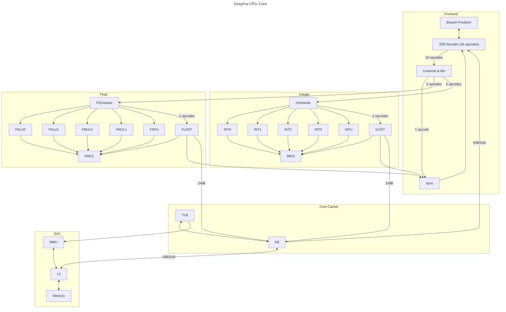

# GREYFOX Architecture

## Overview

The GREYFOX architcture is designed to be ...

## Block Diagram 

## Block Description: 

### INTX (INTeger alu)
The INTX block is a generic integer ALU capable of performing all integer operations besides divide and modulus. 

## ISFU (Integer Special Function Unit)
The ISFU is an ALU only capable of performing integer divide and modulus. 

## ILDST (Integer LoaD/STore)

ILDST acts as a load store unit for the integer pipeline and cross pipeline conversion operations

### FALUX (Floating point ALU X)
The FALUX block is a generic floating point ALU, capable of all floating point operations besides divide, and trig operations. 

## FSFU (Floating point Special Function Unit)
The FSFU is an ALU only capable of performing floating point divide, cos, sin, tan, sqrt, rsqrt, rcp, exp, ln, and log10 operations. 

## FLDST (Integer LoaD/STore)

FLDST acts as a load store unit for the floating point pipeline and cross pipeline conversion operations

## FREG / IREG

Floating point REGister file and Integer REGister file. Maintain the datastorage for HW physical registers

## TLB

The Translation Lookaside Buffer is a small cache of VA translations made by the MMU for data stored in D$. 

## MMU

The Memory Management Unit is repsonsible for traversing page tables to map a requests virtual address, process ID and guest ID to physical memory. It is also responsible for maintaining read/write/execute permissions for all memory requests. 

## D$

Is a unified L1 for data and instructions inside a single GreyFox Core. It is physically tagged. 

## L2

Is a unified L2 across all GreyFox cores and other SoC blocks. This is the highest cache that contains fully coherent data between the cores. It is also responsible for processing the atomic operations.

### Register Renaming
GreyFox HW registers are treated as single static assignment. So, once a value is assigned to them
they do not change until they are deallocated. 
Every register written (except in movs) allocates a new renamed register ID linearly. 
A renaming table keeps track of which HW register is the latest allocated for the ISA register. 
A move operation may be collapsed in the register renaming stage by just copying the renamed ID to the written registers ID in the remapping table. This is only done if the read register does not expand the span of registers covered by the cascade significantly to avoid deadlocks from occuring from a stale HW register living indefinitely as it keeps getting renamed. 

#### Register File Defrag
When the window of live registers in the renaming table exceeds the register defrag lifetime threshold, the renaming stage will insert mov operations in inactive slots of the cascade that move the oldest register to a newly allocated position. This prevents registers that are not overwritten frequently from holding up the register deallocation procedures. 

### Cascade
A cascade contains all the information required to represent the state of the processor at a specific point in the instruction stream. They are tracked for any point the CPU may need to rewind its execution state to:
- Section where a branch is predicted but not known. 
- Memory Fetch/Store (which may trigger an exception)

They contain the following information:

- Register Renaming Table
- LR, PC, SP, Flag registers
- Last register allocated
- Earliest rename register used

A cascade can exist in the following states:

- INACTIVE: Cascade is not currently allocated to any instructions
- ACTIVE: Cascade has pending instructions in the pipe, but we aren't sure if this path is valid yet. 
  ALU processing may be performed during this, but no writes to memory should be buffered until a commit, or invalidate is recieved.  
- COMMIT: We are sure the cascade is valid, writes can be commited to memory
- INVALIDATE: We are sure the cascade is invalid, writes to memory must be discarded. ALU processing may be skipped. 

To rewind the state of the CPU to a previous cascade the following is performed:

1) All cascades between the cascade being rewound and the current cascade are invalidated
2) A new cascade is allocated with the following state:
    - The Register Renaming Table is from the rewind cascade
    - The LR, PC, SP, Flags are from the rewind cascade
    - The last register allocated will come from the previous cascade, not the rewind cascade. 
        - This lets the previous opcodes in the pipe flush out through the normal flow
    
